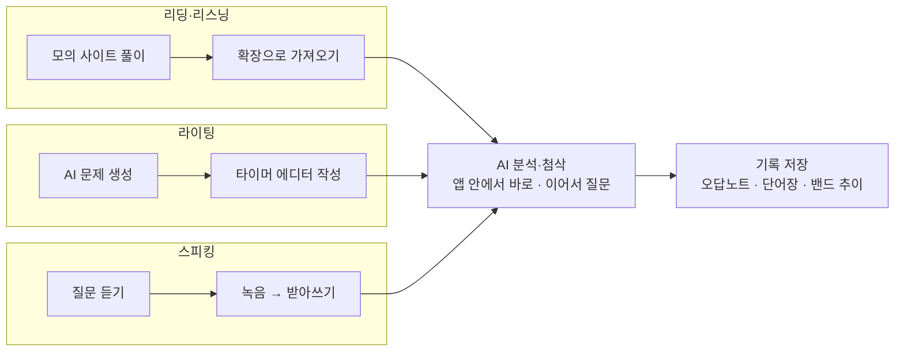
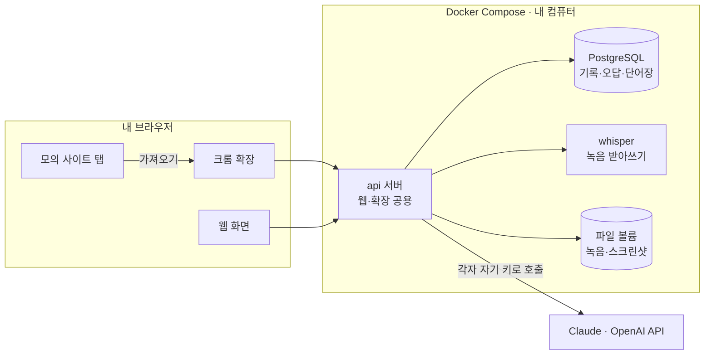

# 토플 AI 학습 웹 서비스 기획서

2026-10-28 기준

## 개요

BandUp Lab은 모의고사 풀이, AI 오답 분석, 라이팅·스피킹 첨삭을 한 화면 흐름으로 묶는 개인용 웹 서비스다. 지금은 모의 사이트, ChatGPT, Claude 창을 오가며 지문과 답을 복사·붙여넣기 하는데, 이 과정을 버튼 하나로 줄이는 게 핵심이다.

- 사용자: 나와 친구들. 각자 자기 컴퓨터에 설치해 쓰고, 데이터는 각자의 DB에만 저장
- 형태: 웹 서비스 + 크롬 확장. Docker로 웹·API·DB를 한 번에 띄운다 (docker compose up)
- 기반: "토플 5.0 준비" 문서의 프롬프트 세트와 11·12월 하루 3시간 플랜
- 핵심 가치: 문제 풀이 → AI 분석 → 오답·어휘 기록이 자동으로 이어지고, 쌓인 기록으로 약점 영역을 보여준다

## 핵심 흐름



리딩·리스닝은 크롬 확장으로 모의 사이트 화면을 가져오고, 라이팅·스피킹은 웹에서 만든 답안을 보내 같은 분석·저장 흐름을 탄다.

## 기능 명세

### 리딩 / 리스닝

모의 사이트는 평소처럼 브라우저에서 풀고, 크롬 확장의 "가져오기" 버튼으로 지문·문항·내가 고른 답을 웹으로 바로 보낸다. 서버가 사이트를 직접 크롤링하는 방식은 쓰지 않는다. 내가 고른 답은 내 브라우저에만 있고, 모의 사이트는 대부분 로그인·동적 화면이라 서버에서는 같은 화면을 볼 수 없으며, 자동 수집은 사이트 약관에 걸릴 수 있기 때문이다.

- 가져오기 버튼: 확장이 모의 사이트 화면 위에 버튼을 띄운다. 누르면 지금 보이는 페이지의 텍스트, 선택된 답, 화면 스크린샷을 한 번에 보낸다
- 사이트별 규칙: 자주 쓰는 사이트는 지문·문항·선지 위치를 정해 둔 규칙(파서)으로 깔끔하게 가져오고, 규칙이 없는 사이트는 페이지 전체 텍스트 + 스크린샷으로 가져온다
- 문제함: 웹의 리딩·리스닝 화면에 가져온 세트가 쌓이고, 내 답이 자동으로 채워진다
- 정답 체크: 사이트 채점 화면을 한 번 더 가져오면 정답이 채워지고, 안 되면 직접 고른다
- 리스닝: 음원은 가져오지 않고, 화면에 보이는 문항·선지만 가져온다
- AI 분석: "분석하기"를 누르면 가져온 텍스트와 틀린 문항이 바로 AI로 가고, 결과 아래에서 이어서 질문한다
- 저장: 오답 유형과 모르는 단어를 오답노트·단어장에 저장
- 예외: 확장을 쓸 수 없는 환경에서는 스크린샷 붙여넣기로 대신한다

### 라이팅

- 문제: Academic Discussion, Email, Build a Sentence 중 고르면 AI가 문제를 생성한다
- 쓰기: 제한 시간 타이머(Discussion 10분, Email 7분)와 단어 수 표시가 있는 에디터
- 피드백: 1\~6 밴드 점수, 문법 오류 표(원문 → 수정 → 이유), 논리 약점, 5.5 모범답안
- 재작성: 모범답안을 가린 상태로 다시 쓰고, 처음 답안과 비교 피드백을 받는다
- 저장: 반복 실수를 오류 노트에 누적, 주간 Top 5 자동 정리

### 스피킹

- 문제: Take an Interview 질문(음성으로 읽어줌) 또는 Listen and Repeat 문장 세트
- 녹음: 준비 시간 후 녹음 버튼, 45초 타이머, 다시 듣기
- 받아쓰기: 녹음을 텍스트로 변환(필러 "어/음"도 그대로 남김)
- 피드백: 유창성, 문법, 내용 구성 밴드와 수정 답변 / Listen and Repeat는 원문과 내 발화 차이 표시
- 저장: 녹음 파일과 피드백을 날짜별로 보관해 1주 전 답변과 비교

### 홈 / 기록

- 오늘의 플랜: 11·12월 플랜의 하루 3시간 배분을 체크리스트로 보여주고, 완료하면 자동 체크
- 기록: 영역별 밴드 추이, 오답노트, 단어장(오답 기반 퀴즈), 녹음 보관함
- 주간 리포트: 일요일에 이번 주 반복 실수 Top 3와 다음 주 시간 조정 제안

## AI 연동 방식

설정에 API 키를 넣으면 웹에서 바로 AI가 분석·첨삭하고, 결과에 이어서 질문도 할 수 있다. 이 방식을 기본으로 하고, 키가 없는 사용자만 프롬프트 전달(복사해서 웹 채팅에 붙이기)로 쓴다.

| 방식 | 동작 | 비용 | 대상 |
| --- | --- | --- | --- |
| API 모드 (기본) | "분석하기"를 누르면 api 서버가 설정된 LLM(Claude, OpenAI 등)에 바로 보내고, 결과가 학습 패널에 실시간으로 표시된다. 아래 입력창으로 이어서 질문 | API 사용량만큼 과금. ChatGPT Plus·Claude Pro 구독과는 별도 | 키를 넣은 사용자 |
| 프롬프트 전달 (대체) | 프롬프트를 복사해 claude.ai·chatgpt.com을 열고, 결과를 붙여넣어 저장 | 기존 구독 그대로 | 키가 없는 사용자 |

### API 모드 동작

- 키 보관: 설정에서 넣은 키는 각자 컴퓨터의 Docker DB에 암호화해서 저장하고, AI 공급자 외의 곳으로는 보내지 않는다
- 모델 선택: 공급자(Claude / OpenAI)와 모델을 설정에서 고르고, 연결 테스트로 확인한다
- 결과 자동 저장: AI가 밴드·오류 목록·오답 유형·단어를 정해진 형식(JSON)으로 함께 돌려주게 해서, 오답노트·단어장·밴드 기록에 자동 저장한다. 결과를 붙여넣을 필요가 없다
- 이어서 질문: 분석 결과 아래 채팅창에서 "Q2 근거 문장 다시 설명해줘"처럼 묻는다. 대화는 문제 세트별로 저장된다
- 사용량 표시: 이번 달 요청 수와 토큰 사용량을 설정 화면에 보여준다
- 친구 배포: 배포한 사람의 키를 넣어 두지 않는다. 각자 자기 키를 넣는다

스피킹 받아쓰기는 공급자와 상관없이 Docker의 whisper 컨테이너가 맡고, 받아쓴 텍스트를 LLM에 보낸다. 발음·억양 평가는 텍스트만으로는 한계가 있어 추후 과제로 둔다.

## 화면 구성

왼쪽 사이드바(홈, 리딩·리스닝, 라이팅, 스피킹, 기록, 설정) + 가운데 작업 영역 + 오른쪽 AI 패널의 3단 레이아웃이다. 화면이 좁으면 사이드바와 패널이 아래로 내려간다. 7개 화면은 `docs/screens/`(원본: [디자인 캔버스](https://claude.ai/artifact/LzFQW8HTFai39ja6hC4xoh))에 있다.

| 화면 | 주요 요소 |
| --- | --- |
| 홈 | D-day, 오늘의 3시간 체크리스트, 영역별 최근 밴드, 오답 단어 퀴즈, 이번 달 주차별 포커스 |
| 리딩·리스닝 | 모의 사이트 바로가기, 크롬 확장 연결 상태, 가져온 문제함(지문·문항·내 답 자동 입력), 오른쪽 AI 패널(정답 체크, AI 분석, 이어서 질문) |
| 라이팅 | 과제 유형 선택, 문제 카드, 타이머·단어 수가 있는 에디터, AI 피드백(밴드, 오류 표, 논리, 재작성 후 공개되는 모범답안), 이어서 질문 |
| 스피킹 | 질문 카드(다시 듣기), 녹음 버튼과 45초 타이머, 내 녹음 재생, 받아쓰기(필러 표시), AI 피드백(항목별 밴드, 가장 큰 약점, 수정 답변), 이어서 질문 |
| 기록 | 영역별 밴드 추이, 오답 유형 순위, 오답노트, 단어장(퀴즈 시작), 녹음 보관함 |
| 설정 | AI 공급자(Claude / OpenAI)·모델·API 키, 연결 테스트, 이번 달 사용량, whisper 모델 크기, 시험일·하루 공부 시간, 백업 |
| 크롬 확장 | 모의 사이트 위 팝업: 감지된 과제 유형, 가져올 항목 체크, "이 화면 가져오기" 버튼 |

## 데이터와 기술 구성

모든 데이터는 각자 컴퓨터에 Docker로 띄운 PostgreSQL에 저장한다. 데이터는 Docker 볼륨에 남아 컨테이너를 지우고 다시 띄워도 유지되고, 외부 서버로는 나가지 않는다.

### 저장 데이터

| 항목 | 내용 |
| --- | --- |
| AI 설정 | 공급자, 모델, 암호화된 API 키 |
| 가져온 문제 | 사이트, 영역, 과제 유형, 지문·문항 텍스트, 내 답, 정답, 스크린샷 경로 |
| 제출물 | 라이팅 답안, 스피킹 녹음 파일 경로와 받아쓰기 |
| AI 분석 | 영역, 입력, 결과(JSON), 밴드, 사용 모델, 토큰 수 |
| AI 대화 | 분석별 이어서 질문한 내용과 답 |
| 오답노트 | 영역, 오답 유형, 문항, 설명 |
| 단어장 | 단어, 뜻, 예문, 틀린 횟수, 마지막 복습일 |
| 플랜 | 월별 하루 배분, 일별 완료 체크 |

### 기술 스택

- 실행: docker compose up 한 번으로 web, api, db, whisper가 함께 뜬다. 친구에게는 저장소 링크와 이 명령어만 주면 된다
- web: React + Vite + Tailwind, nginx로 서빙
- api: Python(FastAPI) + SQLAlchemy. 웹 화면과 크롬 확장이 같은 API를 쓴다
- llm: api 서버가 Claude·OpenAI 공식 SDK로 호출하고 응답을 실시간(스트리밍)으로 웹에 넘긴다. 공급자는 어댑터 하나로 바꿔 끼운다
- db: PostgreSQL, 데이터와 암호화된 API 키는 Docker 볼륨에 저장
- whisper: faster-whisper 컨테이너로 받아쓰기 (CPU에서도 동작, 모델 크기는 설정에서 선택)
- 파일: 녹음·스크린샷은 볼륨 폴더에 두고 DB에는 경로만 저장
- 백업: pg\_dump 기반 백업·복원 명령을 하나씩 제공
- 크롬 확장: 내 컴퓨터의 api 주소(localhost)로 보낸다. 처음엔 개발자 모드로 설치하고, 스토어 등록은 추후



크롬 확장과 웹 화면은 모두 내 컴퓨터의 api 서버로만 데이터를 보내고, AI 호출은 api 서버가 각자의 키로 대신한다.

### 권장 폴더 구조

Python 서비스(api, stt)는 [Python Packaging User Guide](https://packaging.python.org/discussions/src-layout-vs-flat-layout/)의 src 레이아웃과 [pyproject.toml 작성 가이드](https://packaging.python.org/guides/writing-pyproject-toml/)를 따른다. 코드가 `src/` 안에 있어서 설치된 패키지 대신 개발 중인 사본을 잘못 테스트하는 일을 막고, 대신 실행 전에 편집 가능 설치(`pip install -e .`)가 필요하다.

```
bandup-lab/
├── docker-compose.yml
├── .env.example              # APP_SECRET, DB 비밀번호 등
├── README.md                 # 친구용 설치 안내
├── backend/                  # api 서버 (Python 패키지)
│   ├── pyproject.toml
│   ├── Dockerfile
│   ├── src/
│   │   └── banduplab/
│   │       ├── __init__.py
│   │       ├── __main__.py   # banduplab-api 명령 진입점
│   │       ├── main.py       # FastAPI 인스턴스 생성, 라우터 등록
│   │       ├── config.py     # 환경 변수 설정
│   │       ├── db.py         # 엔진, 세션
│   │       ├── models.py     # 테이블
│   │       ├── schemas.py    # 요청·응답 형식
│   │       ├── security.py   # API 키 암호화·마스킹
│   │       ├── prompts.py    # 프롬프트 세트, JSON 응답 파싱
│   │       ├── llm/          # 공급자 어댑터 (anthropic, openai)
│   │       ├── services/     # 분석·첨삭·받아쓰기 호출 로직
│   │       └── routers/      # settings, imports, analysis, writing, speaking, notes
│   └── tests/
├── stt/                      # whisper 받아쓰기 서비스 (별도 Python 패키지)
│   ├── pyproject.toml
│   ├── Dockerfile
│   └── src/banduplab_stt/
├── web/                      # React + Vite
└── extension/                # 크롬 확장 (Manifest V3)
```

### 코드 구조 원칙

| 계층 | 역할 | 의존해도 되는 것 |
| --- | --- | --- |
| routers | HTTP 요청 받기, 입력 검증, 응답 형식 맞추기 | services, schemas |
| services | 학습 로직 (프롬프트 만들기, AI 호출, 결과를 오답노트·단어장에 저장) | llm, prompts, models |
| llm | 공급자별 SDK 호출을 같은 인터페이스로 감싸기 | 공급자 SDK만 |
| models, db | 테이블과 세션 | SQLAlchemy만 |

- 공급자 교체: services는 `LLMClient` 인터페이스만 보고, Claude·OpenAI 차이는 `llm/` 안에서 끝낸다
- 테스트: 가짜 LLM 클라이언트를 끼워 넣어 API 키 없이 services와 routers를 검증한다
- pyproject.toml: `[build-system]`과 `[project]`(name, version, requires-python, dependencies)를 두고, 개발 도구는 `[project.optional-dependencies]`의 dev 그룹, 실행 명령은 `[project.scripts]`로 등록한다

```toml
[build-system]
requires = ["hatchling"]
build-backend = "hatchling.build"

[project]
name = "banduplab-api"
version = "0.1.0"
requires-python = ">=3.12"
dependencies = ["fastapi", "uvicorn[standard]", "sqlalchemy>=2.0", "psycopg[binary]", "pydantic-settings", "cryptography", "anthropic", "openai"]

[project.optional-dependencies]
dev = ["pytest"]

[project.scripts]
banduplab-api = "banduplab.__main__:main"
```

### 저작권·개인정보 원칙

- 가져온 모의 문제는 각자 자기 DB에만 개인 학습용으로 저장한다. 친구끼리 문제 원문을 공유하거나 한곳에 모으는 기능은 넣지 않는다 (저작권과 사이트 약관 문제)
- 서버가 모의 사이트를 자동으로 크롤링하지 않는다. 사용자가 보고 있는 화면만 확장으로 가져온다
- 모든 서비스는 내 컴퓨터(localhost)에서만 열리고, 밖으로 나가는 건 AI 공급자 호출뿐이다

## MVP 범위와 열린 질문

11월 안에 직접 쓰기 시작하려면, 학습 시간을 깎지 않도록 MVP를 작게 잡는다.

### MVP (1차)

- [ ] Docker Compose 구성 (web, api, db, whisper) + 설치 안내 README
- [ ] 설정: AI 공급자·모델·API 키, 연결 테스트, 시험일, 백업
- [ ] 사이드바 + 홈(오늘의 체크리스트)
- [ ] 크롬 확장: 모의 사이트 위 "가져오기" 버튼 → 텍스트·내 답·스크린샷 전송 (첫 사이트 1곳은 전용 규칙)
- [ ] 리딩·리스닝: 가져온 문제함 + 정답 체크 + AI 분석·이어서 질문
- [ ] 라이팅: 문제 생성 + 타이머 에디터 + AI 첨삭 + 재작성 비교
- [ ] 스피킹: 녹음 + whisper 받아쓰기 + AI 피드백
- [ ] 기록: 오답노트·단어장 목록과 검색

### 2차

- 키가 없는 사용자용 프롬프트 전달 모드
- 사이트별 가져오기 규칙 추가
- 기록 화면의 밴드 추이·오답 유형 차트, 단어장 퀴즈, 녹음 보관함
- 주간 리포트
- 한 서버를 여러 명이 같이 쓰는 모드 (로그인, 사용자별 데이터 분리)

### 확장 로드맵 (3차 이후)

기록이 쌓인 뒤 AI를 단순 호출에서 에이전트 구조로 넓힌다. 3차의 두 기능은 같은 도구 목록(플랜 조회, 오답 검색, 퀴즈 생성 등)을 공유한다.

| 차수 | 기능 | 이 서비스에서 얻는 것 | 구현 |
| --- | --- | --- | --- |
| 3차 | 학습 코치 에이전트 | "이번 주 뭐가 부족해?"에 기록을 직접 조회해 답하고, 다음 주 시간 배분을 제안 | 공급자 SDK의 도구 호출 |
| 3차 | MCP 서버 | Claude 데스크톱 앱 같은 MCP 클라이언트에서 내 오답노트·플랜을 바로 사용. API 키 없이 구독만 있는 사용자의 무료 경로 | MCP Python SDK, localhost 전용 |
| 4차 | RAG (내 기록 검색) | 분석·첨삭 때 과거 같은 오답 사례와 반복 실수를 함께 넣어 개인화 | PostgreSQL pgvector + 로컬 임베딩 모델 |
| 5차 | LangGraph 워크플로우 | 라이팅 재작성 루프, 플랜 조정 승인처럼 사용자를 기다리는 여러 단계 흐름 | LangGraph의 중단·재개 실행과 사람 확인 단계 |

### 열린 질문

- 웹 서비스를 직접 개발할지, Claude Code 같은 도구로 같이 만들지?
- 가져오기 규칙을 먼저 만들 모의 사이트 1곳은 어디로 할지? (추천: 문제 수가 많은 toeflmocktests.com)
- 나중에 한 서버를 같이 쓰는 모드가 필요한지, 각자 설치로 충분한지?
